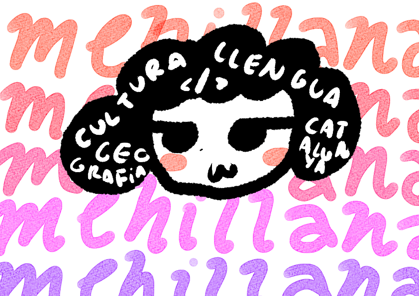
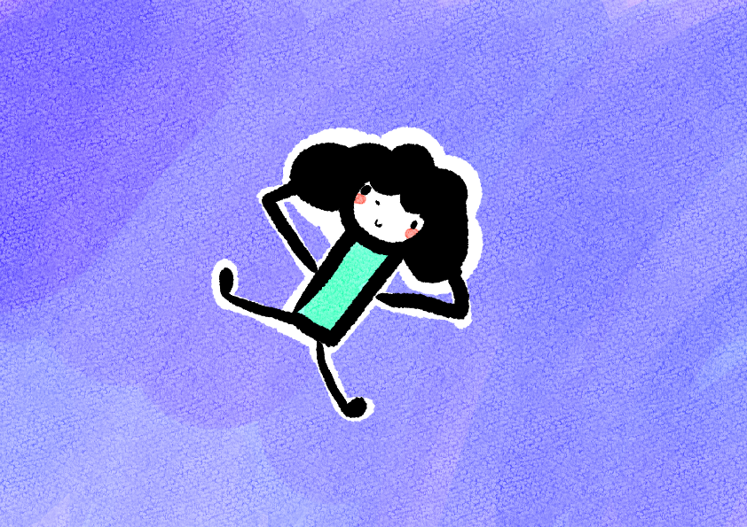
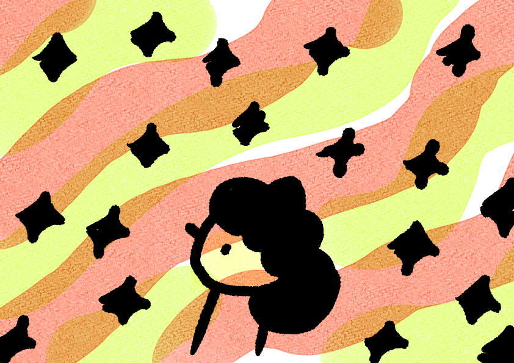
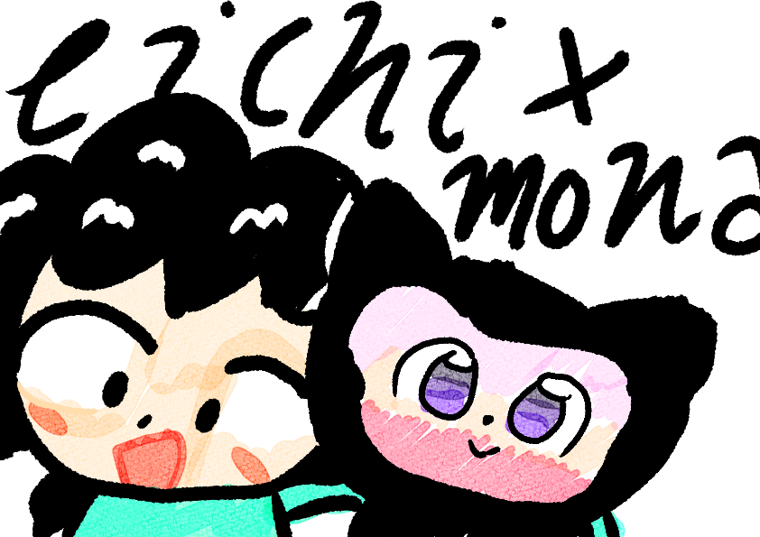

# Etienne González Zárate

### Programari, llengua i imaginació

**Desenvolupador de programari • Sant Cugat del Vallès • Catalunya**

[PROJECTES](#-projectes) • [IL·LUSTRACIONS](#-il·lustracions-personals) • [INTERESSOS](#-constel·lació-dinteressos) • [EXPLORA](#-explora)

---

> *M'agrada imaginar la tecnologia com un lloc habitable: fet de llengua, memòria, curiositat i petits gestos quotidians.*

## 🧩 Benvinguda/a al meu espai

Soc **Etienne González Zárate** — a GitHub, **[@mehillana](https://github.com/mehillana)** —, desenvolupador de programari a Sant Cugat del Vallès. Aquest perfil recull el meu treball, els meus experiments i els projectes que construeixo amb cura i curiositat.

Em mou la tecnologia amb context: eines útils, accessibles i respectuoses amb les persones, juntament amb projectes que construeixen mons propis i proposen una manera diferent de mirar.

`CODI` &nbsp; 🧭 &nbsp; `CULTURA` &nbsp; 🧭 &nbsp; `TERRITORI` &nbsp; 🧭 &nbsp; `IMAGINACIÓ`

---

## 🧰 Projectes

<table>
<tr>
<td width="50%" valign="top">

### 🫓 Naan

#### La meva app més robusta

**[Repositori 🫓](https://github.com/mehillana/naan)**

Naan és l'app més robusta i completa del meu perfil: una aplicació de xat moderna, privada i flexible, amb xifratge de punta a punta, sales en temps real i una experiència rica en diverses llengües i dispositius.

- 💬 Missatgeria directa i sales en temps real.
- 🔐 Xifratge de punta a punta i enllaços de sala segurs.
- 🗳️ Enquestes, llistes compartides, notes de veu i dibuix.
- 🌈 Temes glassmorphism i 7 llengües amb suport RTL.
- 📦 Funciona com a app estàtica en un únic fitxer o amb servidor Node.js.

</td>
<td width="50%" valign="top">

### 🪻 Lavender

#### Un calendari que escolta

**[Obre Lavender 🌿](https://mehillana.github.io/lavender)** • **[Repositori 🪻](https://github.com/mehillana/lavender)**

Lavender transforma frases escrites en esdeveniments, celebracions i tasques de diversos dies. Ofereix vistes diària, setmanal, mensual, anual i d'agenda, notes dins dels esdeveniments, calendari lunar i reptes estacionals.

- 🌄 Entrada en llenguatge natural.
- 📅 Diferents maneres de consultar i planificar el temps.
- 🌙 Estacions, fases lunars i reptes.
- 🔒 Sense compte ni seguiment: les dades romanen al navegador.
- 🧪 Codi obert i disponible com a aplicació web.

</td>
</tr>
<tr>
<td width="50%" valign="top">

### 🎮 Farmia

#### Un videojoc de gestió i misteri

**[Juga a Farmia 🌱](https://mehillana.github.io/farmia)** • **[Repositori 🌱](https://github.com/mehillana/farmia)**

Farmia és un videojoc de gestió per al navegador ambientat en un poble de muntanya. La persona jugadora cuida un hort, gestiona recursos i comercia al mercat mentre decideix com afrontar les tasques i els misteris del poble.

- 🏞️ Paisatge muntanyós i exploració amb càmera 3D.
- 🌾 Cultiu, aigua, collita i provisions per a l'hivern.
- 🕯️ Gestió del foc, la llenya i la feina dels veïns.
- 🐗 Interaccions, animals i elements misteriosos.
- 🌟 Desenvolupat amb HTML, CSS i JavaScript.

</td>
<td width="50%" valign="top">

### 📝 Noséquè

#### Divulgació cultural, lingüística i geogràfica

**[Visita Noséquè 🌐](https://mehillana.github.io/noseque)** • **[Repositori 📝](https://github.com/mehillana/noseque)**

Noséquè és una aplicació web en català que combina història, llengua i geografia amb una estètica artesana d'aquarel·la i llibreta. Inclou filtres per categoria i reaccions locals per explorar curiositats culturals.

- 🏛️ Història i curiositats culturals.
- 🗺️ Geografia i context territorial.
- 🗣️ Llengua i divulgació lingüística.
- 💧 Estètica artesanal d'aquarel·la i llibreta.
- 🗒️ Publicació estàtica i disponible a GitHub Pages.

</td>
</tr>
<tr>
<td width="50%" valign="top">

### 🍲 Chaufa

**[Repositori 🍲](https://github.com/mehillana/chaufa)**

Chaufa és un projecte propi relacionat amb la gastronomia i la cultura de fusió. El repositori encara no té pàgina pública.

</td>
<td width="50%" valign="top">

### 📰 La Conferència

#### L'actualitat política desmuntada

**[Llegeix La Conferència 📰](https://mehillana.github.io/laconferencia/)** • **[Repositori](https://github.com/mehillana/laconferencia)**

Webcòmic satíric en català sobre l'actualitat política, amb lector d'una tira i vista en columna.

</td>
</tr>
</table>

---

## 🎨 Il·lustracions personals

---

## 🧭 Una manera de fer

### Tecnologia amb context

El programari no viu en el buit. Les llengües en què es crea, les persones a qui serveix i els llocs des d'on s'imagina formen part del projecte. M'interessa una tecnologia situada i pensada per a les persones.

### Privacitat com a gest de respecte

Lavender i Naan parteixen de la idea que una eina digital ha de tractar les persones amb respecte. Sense dades comercials de pas i amb opcions que prioritzen el control local i el xifratge, la privacitat és una manera concreta de dissenyar.

### Llengua com a espai de creació

Crear programari en català amplia els espais on aquesta llengua pot ser una llengua de vida contemporània. Les paraules, les interfícies i les opcions d'ús també construeixen identitat.

### Joc, relat i experimentació

No tots els projectes han de resoldre el mateix problema. Alguns poden explorar una idea, construir un món o fer-nos mirar un costum des d'un altre angle. Farmia combina aquests interessos amb la mecànica de joc i la narració.

| **CURA** | **CURIOSITAT** | **IDENTITAT** | **JOC** |
|:---:|:---:|:---:|:---:|
| Privacitat i atenció | Aprendre i connectar idees | Llengua i territori | Imaginar sense demanar permís |

---

## 🧰 Constel·lació d'interessos

No són compartiments separats, sinó punts que sovint es connecten entre si:

- **Llengua i tecnologia** — català en productes digitals, llenguatge natural i eines que parlen amb les persones.
- **Geografia i territori** — mapes, paisatges i les maneres com organitzem i expliquem l'espai.
- **Història i cronologia** — memòries, processos socials i fils que uneixen el passat i el present.
- **Música i escolta** — atenció al detall i la relació entre so, emoció i context.
- **Gastronomia i fusió** — cuines que expliquen trobades culturals, tècnica, origen i imaginació.
- **Disseny i identitat visual** — colors i atmosferes que ajuden cada projecte a trobar la seva veu.

### Una petita paleta personal

*Lavanda per a la calma; violeta per a la imaginació; colors vius per recordar que també hi ha joc.*

---

## 🍜 Cultura també és taula

La gastronomia és una altra manera d'explicar el món: tècniques, ingredients i històries que viatgen i es transformen. Entre els meus gustos hi ha el sushi, la yucca fregida i les cuines que connecten tradicions diferents.

M'agrada pensar que passa una cosa semblant amb els projectes: les idees més interessants sovint apareixen quan disciplines, llocs i sensibilitats diferents comparteixen espai.

---

## ⏳ Temps a GitHub

---

## 🗺️ Explora

| Projecte | Què hi trobaràs | Enllaç |
|---|---|---|
| **Naan** | L'app més robusta del meu perfil: xat privat, xifrat i en temps real. | [github.com/mehillana/naan](https://github.com/mehillana/naan) |
| **Lavender** | Calendari privat i de codi obert amb entrada en llenguatge natural. | [mehillana.github.io/lavender](https://mehillana.github.io/lavender) |
| **Farmia** | Videojoc de gestió i misteri en un poble de muntanya. | [mehillana.github.io/farmia](https://mehillana.github.io/farmia) |
| **Noséquè** | Divulgació cultural, lingüística i geogràfica en català amb estètica artesana. | [mehillana.github.io/noseque](https://mehillana.github.io/noseque) |
| **Chaufa** | Projecte gastronòmic i cultural en desenvolupament. | [github.com/mehillana/chaufa](https://github.com/mehillana/chaufa) |
| **La Conferència** | Webcòmic satíric en català sobre l'actualitat política. | [mehillana.github.io/laconferencia](https://mehillana.github.io/laconferencia/) |
| **Perfil GitHub** | Repositoris, experiments i nous projectes. | [github.com/mehillana](https://github.com/mehillana) |

Si algun d'aquests projectes et desperta curiositat, passeja-hi, explora'n els detalls i fes-me saber què t'ha cridat l'atenció.

---

### Gràcies per passar per aquí 🌿

*Un perfil en construcció permanent, com qualsevol bon mapa.*

**[GitHub • @mehillana](https://github.com/mehillana)**

